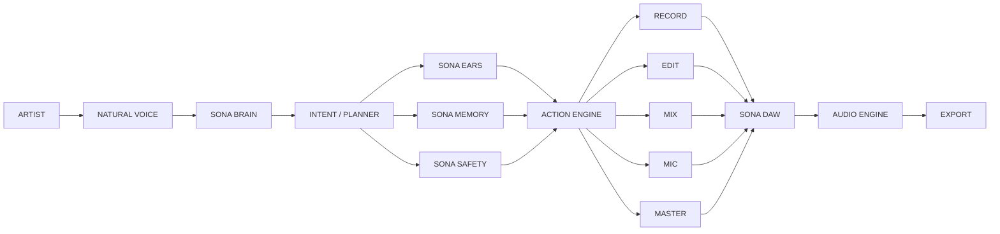
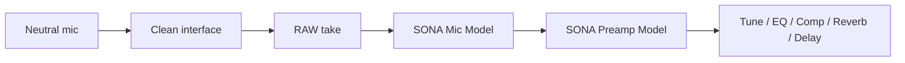

# SONA

The studio that listens. Speak. Record. Create.

Other DAWs hand you tools. SONA is the engineer in the room: you talk the way you would to a person, and the session changes only through a command the Action Engine can undo.

## Run

```bash
npm install
npm run dev
npm test
npm run typecheck
npm run lint
npm run build
```

Desktop Chrome. Headphones while recording, so talkback does not print into the take. No account and no backend. Sessions live in IndexedDB in this browser.

Voice replies are on by default. The Voice button mutes them. If this browser has no Web Speech API, type the command. SONA does not invent a transcript.

## How a command moves

The brain never writes the session. The planner returns plain data:

```ts
{ track, action, amount, mode: "nondestructive" }
```

Safety may hold that data for a yes or no. The Action Engine is the only writer. Every command lands in the command log with an inverse, and undo puts the previous project back, the same object.



The planner in this build is deterministic and does not call a network. `Planner` is the interface a model can implement later. `Engineer.interpret` is the optional language-model seam. It stays unused unless both `VITE_SONA_LLM_URL` and a parsed miss are present. See `.env.example`. A model still has to come back as commands. It does not get a side door into the session.

## Listening

Three channels stay separate:

- **Command** — talk that may become DAW commands.
- **Performance** — speech during a take, kept as lyrics.
- **Analysis** — Ears reads audio, never a transcript.

While a take is rolling, speech is performance unless it starts with the wake word **SONA**, or you have opened the command window (`commands on`). A lyric such as "turn me up" does not move the fader. Typed text is always a command, because the box is the command channel. "SONA, stop" stops a take. The Stop button does too.

Many browsers do not give per-word speech times. SONA splits the real transcript evenly across the span the recognizer was actually active. It does not write words that were not heard. If recognition is unavailable, the take has no lyric index until a browser returns text.

## Capture path

Hardware stays neutral: a compatible mic into a clean preamp or interface. SONA stores that digitized signal as the raw take. Playback is a render:



The raw buffer is never rewritten. Swapping a mic re-renders. The four models in this build are original curves: Warm Tube, Modern Condenser, Smooth Vintage, Bright Presence. They are not models of manufactured microphones. Branded models wait on a registry that carries licensing metadata. See `docs/ROADMAP.md`.

Find My Mic asks for about fifteen seconds of voice, ranks those four with a one-line reason, and can A/B two renders of the same raw sample. "Three." answers exactly: "Got it. I'll use that as your preferred mic." That choice is the default on new takes. If the browser has no microphone, or the pass is silence, SONA says so and does not invent a ranking.

## Modes

Artist is the default: waveform, lyrics, record status, and the conversation. Creator opens the timeline, faders, and master that already exist. Engineer is a mode switch and a Phase 2 panel. It does not draw knobs that do nothing. All three sit on one session. `AudioEngine` implements `AudioEnginePort` so a later desk can replace the prototype engine.

## Investor path

The proof pass this build is aimed at:

1. Load the beat
2. Find my mic
3. Punch in on a lyric
4. Widen the doubles
5. "What you hearing?"
6. Fix
7. Mix
8. Master
9. Bounce

"Load the beat" drops in a generated scratch pattern so there is something to record on. It is not your instrumental. "Import a beat" takes a real audio file, by the picker or by dropping it on the window, and places that file as the raw beat.

## What you can say

Transport: record, stop, play, from the top, run it back, SONA let's work.

Punch and takes: punch me in at "I been on the road", save this take, use take 2 for the verse and take 3 for the hook.

Tune: tune it tighter, less tune, key of A minor. Tune is monophonic overlap-add. It is not formant-preserving and it is not live pitch correction.

Mix: bring the vocal up 3 db, make it brighter, more air, less harsh, bigger reverb, widen the doubles.

Mic: find my mic, let me hear 1 and 3, three, put me on a warmer mic, try something brighter.

Ears: what you hearing, fix the vocal. Ears can flag clipping, a quiet vocal, sibilance, mud, noise floor, and timing drift against the click. The loudness number is an estimate from RMS, not BS.1770.

Memory: same as last time. The profile keeps preferred mic, preamp, vocal chain, loudness target, tune strength, and reverb taste.

Export: bounce my master, bounce my stems. Master is a WAV. Stems are one WAV per track in a zip. The click is not in the bounce.

A move of 6 dB or more, a delete, or recording over audio already there waits for yes. No leaves it alone.

## Limits

This is the Phase 1 booth, not the full desk. Routing, buses, automation, plugin hosting, hardware I/O, and the SONA ONE interface are later, and they are not simulated here. Details are in `docs/ROADMAP.md`.
